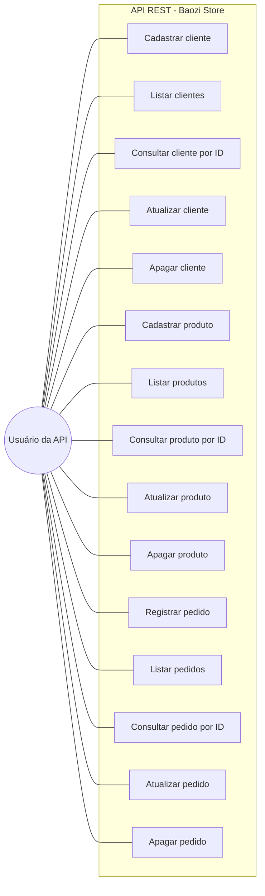

# API REST — Baozi Store

Trabalho de **Desenvolvimento Web Back-End**: API REST simples para controle de clientes, produtos e
pedidos da loja fictícia *Baozi Store*, que vende pãozinho chinês.

Aluno: **Igor Henrique Afonso — RU 5485028**

## Tecnologias

- Java (JDK 21+ — compilado em nível 21, testado no JDK 27)
- Spring Boot 4.1.1
- Spring Web (MVC / REST com JSON)
- Spring Data JPA (Hibernate)
- Swagger / OpenAPI (springdoc-openapi) para documentação da API
- Banco relacional H2 em arquivo (`./data/baozistore.mv.db`)
- Maven (via Maven Wrapper — não precisa instalar o Maven)
- Postman para os testes

## Como executar

```bash
# Windows (PowerShell / CMD)
.\mvnw.cmd spring-boot:run

# Linux / macOS
./mvnw spring-boot:run
```

A API sobe em `http://localhost:8080`.
Documentação interativa (Swagger UI): `http://localhost:8080/swagger-ui.html`
Especificação OpenAPI em JSON: `http://localhost:8080/v3/api-docs`
Console do banco: `http://localhost:8080/h2-console`
(JDBC URL `jdbc:h2:file:./data/baozistore`, usuário `sa`, senha em branco).

As tabelas `CLIENTE`, `PRODUTO` e `PEDIDO` são criadas automaticamente pelo Spring Data JPA
(`spring.jpa.hibernate.ddl-auto=update`).

## Arquitetura (padrão MVC do Spring)

```
src/main/java/com/baozistore
├── BaoziStoreApplication.java   # classe principal
├── model                        # entidades JPA
├── repository                   # interfaces JpaRepository
└── controller                   # endpoints REST (@RestController)
```

Fluxo de cada requisição:

```
Cliente HTTP (Postman)  ->  Controller (@RestController)  ->  Repository (Spring Data JPA)  ->  Banco H2
        <-  resposta JSON + status HTTP  <-
```

## Entidades e campos

### Cliente
| Campo | Tipo Java | Tipo no banco |
|---|---|---|
| id | Long | BIGINT (chave primária, auto incremento) |
| nome | String | VARCHAR |
| clienteDesde | LocalDate | DATE |

### Produto
| Campo | Tipo Java | Tipo no banco |
|---|---|---|
| id | Long | BIGINT (chave primária, auto incremento) |
| nome | String | VARCHAR |
| preco | BigDecimal | NUMERIC |
| estoque | Boolean | BOOLEAN |

### Pedido
| Campo | Tipo Java | Tipo no banco |
|---|---|---|
| id | Long | BIGINT (chave primária, auto incremento) |
| clienteId | Long | BIGINT (cliente que comprou) |
| produtoId | Long | BIGINT (produto comprado) |
| quantidade | Integer | INTEGER (quantidade comprada) |

## Endpoints implementados

Todos os endpoints consomem e produzem **JSON**.

| Método | Rota | Descrição | Status de sucesso | Erro |
|---|---|---|---|---|
| POST | `/clientes` | Cadastrar cliente | 201 Created | — |
| GET | `/clientes` | Listar todos os clientes | 200 OK | — |
| GET | `/clientes/{id}` | Consultar cliente por ID | 200 OK | 404 Not Found |
| PUT | `/clientes/{id}` | Atualizar cliente (opcional) | 200 OK | 404 Not Found |
| DELETE | `/clientes/{id}` | Apagar cliente | 204 No Content | 404 Not Found |
| POST | `/produtos` | Cadastrar produto | 201 Created | — |
| GET | `/produtos` | Listar todos os produtos | 200 OK | — |
| GET | `/produtos/{id}` | Consultar produto por ID | 200 OK | 404 Not Found |
| PUT | `/produtos/{id}` | Atualizar produto (opcional) | 200 OK | 404 Not Found |
| DELETE | `/produtos/{id}` | Apagar produto | 204 No Content | 404 Not Found |
| POST | `/pedidos` | Registrar pedido | 201 Created | — |
| GET | `/pedidos` | Listar todos os pedidos | 200 OK | — |
| GET | `/pedidos/{id}` | Consultar pedido por ID | 200 OK | 404 Not Found |
| PUT | `/pedidos/{id}` | Atualizar pedido (opcional) | 200 OK | 404 Not Found |
| DELETE | `/pedidos/{id}` | Apagar pedido | 204 No Content | 404 Not Found |

### Exemplos de JSON

POST `/produtos`
```json
{
  "nome": "Baozi de Porco",
  "preco": 9.90,
  "estoque": true
}
```

POST `/clientes`
```json
{
  "nome": "Igor Henrique Afonso 5485028",
  "clienteDesde": "2026-10-12"
}
```

POST `/pedidos`
```json
{
  "clienteId": 1,
  "produtoId": 1,
  "quantidade": 6
}
```

Resposta do POST `/pedidos` (201 Created)
```json
{
  "id": 1,
  "clienteId": 1,
  "produtoId": 1,
  "quantidade": 6
}
```

## Estudo de caso (texto para o documento de entrega)

A Baozi Store é uma pequena loja que vende pão chinês. Para melhorar a organização do negócio, foi
criado um sistema simples para controlar clientes, produtos e pedidos.

Um cliente chamado **Igor Henrique Afonso 5485028** realizou seu cadastro no sistema em 12/10/2026.
O produto vendido pela loja chama-se **Baozi de Porco**, custa **R$ 9,90** e é vendido por unidade.
Em um determinado momento, o cliente realizou um pedido de **6 unidades** do produto.
O sistema registra o cliente, o produto comprado e a quantidade solicitada, facilitando o controle da loja.

## Documentação Swagger / OpenAPI

Com a aplicação rodando, acesse **<http://localhost:8080/swagger-ui.html>**. O Swagger UI lista as três
entidades com os 15 endpoints, mostra o JSON de cada entidade e permite executar as requisições pelo
navegador (botão *Try it out*) — serve como documentação da API para anexar ao trabalho.

A especificação em JSON fica em <http://localhost:8080/v3/api-docs>.

## Testes no Postman

1. Suba a aplicação (`.\mvnw.cmd spring-boot:run`).
2. No Postman: **Import** → arquivo `postman/BaoziStore.postman_collection.json`.
3. Execute na ordem e tire os prints: Criar Produto → Criar Cliente → Criar Pedido →
   Listar todos (das três entidades) → Consultar por ID → Apagar.

A coleção já traz a variável `baseUrl = http://localhost:8080` e os corpos preenchidos com os dados do
estudo de caso acima.

## Diagrama de Caso de Uso

Arquivo UML: [`docs/diagrama-caso-de-uso.puml`](docs/diagrama-caso-de-uso.puml)
(renderize em <https://www.plantuml.com/plantuml> para exportar a imagem e colar no documento).


